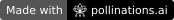

# Fieldglass

[](https://pollinations.ai/?ref=badge) [](https://pollinations.ai/?ref=badge)

Made with [pollinations.ai](https://pollinations.ai/?ref=badge).

Point your camera at a rock, a leaf or a building. A Pollinations vision model tells
you what it is, three things you can confirm with your own eyes, and what a second
photo would settle — then reads it aloud so you can listen while you look.

Live: https://rekty.github.io/fieldglass/

## How it works

1. **Sign in with Pollinations.** The page runs Pollinations' device flow
   (`POST https://enter.pollinations.ai/api/device/code`, then polls
   `/api/device/token`). You approve a short code in the browser; the access token
   stays in `sessionStorage` for that tab only. Nothing is pasted, and the page holds
   no owner key.
2. **Take a picture.** `getUserMedia` with `facingMode: environment`, the photo
   picker (`capture="environment"`) when there is no camera, or **Try a sample
   photo** (`docs/sample.jpg`) to see a reading without a camera at all. The frame is
   scaled to at most 1024 px and sent as a JPEG data URI. Nothing is uploaded before
   you take, choose or load a picture.
3. **Read it.** `POST https://gen.pollinations.ai/v1/chat/completions` with
   `openai/gpt-5.4-nano` — free (`paid_only: false`) and the model's
   `input_modalities` include `image`. The reply is a JSON object:
   `title`, `what`, `confidence`, `overview`, `noticing[3]`, `uncertain`.
   The prompt forbids guessing silently: `confidence` is `low` when the photo does
   not show the identifying features, and `uncertain` names what is missing.
4. **Ask more.** The same model with the same photo and one question, appended under
   the reading.
5. **Listen.** `POST https://gen.pollinations.ai/v1/audio/speech` with
   `openai/tts-1` reads the reading back.

Every model call bills **your own** Pollinations balance.

## Models

| Role | Model | Why |
|---|---|---|
| Reads the photo | `openai/gpt-5.4-nano` | free, and accepts `image` input |
| Fallbacks in the dropdown | `openai/gpt-5.3-codex`, `minimax/minimax-m3.1-flash`, `openai/gpt-6.1-terra` | also free, also accept `image` input |
| Read aloud | `openai/tts-1` | free speech model |

The picker is built from the same four IDs in `index.html` (`MODELS`), so a reviewer
can see exactly which models the page can call.

## Run it

No build, no dependency:

```bash
python3 -m http.server 8781
# open http://localhost:8781
```

A camera needs `https` or `localhost`. Without one, use **Choose a photo** or
**Try a sample photo**.

## Files

| Path | What |
|---|---|
| `index.html` | the whole app: UI, device sign-in, camera and photo handling, prompt, reading card, read-aloud |
| `docs/screenshot.png` | the app showing a reading |
| `docs/badge-made-with.svg` | the official “Made with pollinations.ai” badge, vendored so the page does not depend on another host |

MIT.
